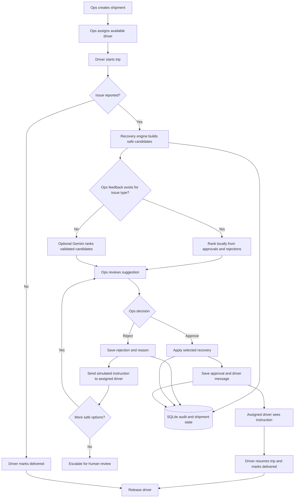
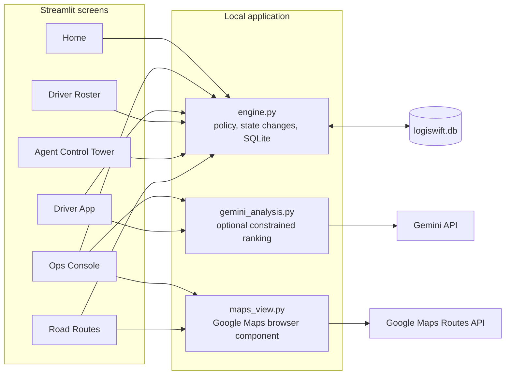

# LogiSwift AI — Shipment Recovery Control Tower

LogiSwift AI is a local Streamlit simulation for shipment operations. It demonstrates how an agent can handle a reported incident, prepare safe recovery options, ask Ops to approve or reject a suggestion, record that decision, and use operator history to rank future choices. Shipments, drivers, approvals, messages, and audit events are stored in SQLite.

> **Simulation only:** this project does not dispatch real drivers, send SMS/email, track live vehicles, or update a carrier system. Google Maps routes are estimates between shipment city endpoints. Gemini is optional and cannot apply a recovery.

## Contents

- [Features and roles](#features-and-roles)
- [Complete workflow](#complete-workflow)
- [Setup and run](#setup-and-run)
- [Configure Google APIs](#configure-google-apis-optional)
- [Run and verify tests](#run-and-verify-tests)
- [Use the app](#use-the-app)
- [Reset the workspace](#reset-the-workspace)
- [Google DevFest workshop guide](#google-devfest-workshop-guide)
- [Future scope](#future-scope)
- [Troubleshooting](#troubleshooting)
- [Project layout](#project-layout)

## Features and roles

| Screen | Purpose |
|---|---|
| Home | Shipment summary and entry point to the workflow. |
| Ops Console | Create and assign shipments, run the breakdown demo, and approve or reject recoveries. Traffic incidents include an interactive route comparison when Maps is configured. |
| Driver App | Simulate the assigned driver starting a trip, reporting an issue, seeing Ops instructions, and marking delivery. |
| Driver Roster | See driver availability and clear the local workspace with one reset button. |
| Agent Control Tower | Read candidate reasoning, approval state, and shipment event history. Ops actions happen in Ops Console. |
| Road Routes | Compare Google driving route alternatives for a saved shipment. |

The app supports simulated traffic delay, vehicle breakdown, driver unavailable, capacity overload, customer unavailable, accident, package damage, and wrong-address issues. Some issues are escalated to a human instead of receiving an automated action.

## Complete workflow

The recovery policy in `engine.py` creates and validates candidate actions. Gemini can rank only those candidates. If there is already Ops feedback for an issue type, the app ranks candidates locally and skips Gemini for that incident. Approval is the gate before a recovery changes the shipment.



### State and integration boundaries



Gemini ranking and Google Maps routes are independent optional integrations. If Gemini is missing or fails, deterministic candidates remain available. If Maps is missing or fails, shipment creation, assignment, approvals, and delivery simulation still work.

### SQLite records

| Table | What it stores |
|---|---|
| `custom_shipments` | Shipment endpoints, priority, deadline, package, and status. |
| `shipment_workflow` | Vendor, assigned driver, issue, lifecycle state, recommendations, approval, and current Ops message. |
| `drivers` | Seeded driver and vehicle records plus availability. |
| `workflow_events` | Append-only style simulation events such as assignment, approval, rejection, and message sent. |
| `decision_feedback` | Ops approvals/rejections, candidate ID, optional reason, and driver/vehicle context for later ranking. |
| `incidents` | Results from the deterministic recovery simulation. |
| `shipment_likes` | Optional saved shipment likes. |

The local SQLite file is created by `connect()` in `engine.py`. Its schema is initialized/migrated when the application connects.

## Setup and run

### Requirements

- Python 3.10 or newer
- Internet access to install Python packages
- Google API keys are optional

Run commands from the repository root, the directory containing `app.py` and `requirements.txt`.

### Linux or macOS

```bash
python3 -m venv .venv
source .venv/bin/activate
python -m pip install --upgrade pip
python -m pip install -r requirements.txt
python -m streamlit run app.py
```

### Windows PowerShell

```powershell
py -m venv .venv
.venv\Scripts\Activate.ps1
python -m pip install --upgrade pip
python -m pip install -r requirements.txt
python -m streamlit run app.py
```

Streamlit prints a local address, usually `http://localhost:8501`. Keep the terminal open while using the app. Stop it with **Ctrl+C**. The first run creates `logiswift.db` in the project directory.

## Configure Google APIs (optional)

Create `.streamlit/secrets.toml` in the project root. Put your own keys there; never paste keys into source code, README, screenshots, workshop materials, or Git commits.

```toml
GEMINI_API_KEY = "your Gemini API key"
GOOGLE_MAPS_API_KEY = "your Maps browser key"
```

`.streamlit/secrets.toml` and local database files are ignored by Git. Restart Streamlit after changing secrets. For hosted deployments, use the platform's secrets manager instead of committing a local secrets file.

### Gemini

- Install is included in `requirements.txt` as `google-genai`.
- The current default model in `gemini_analysis.py` is `gemini-3.8-flash`; override it with the `GEMINI_MODEL` environment variable before starting Streamlit.
- After a rate-limit or transient error, the app tries `gemini-3.6-flash` and then `gemini-3.5-flash-lite`. Set `GEMINI_FALLBACK_MODELS` to a comma-separated model list to override the fallbacks, or set it to an empty value to disable them.
- Fallback only helps when another model has remaining model-specific capacity. Google also applies quotas at project level, so a project-wide/daily quota can block every model; the app then keeps deterministic recommendations and reports the failure. See Google's [rate limits](https://ai.google.dev/gemini-api/docs/rate-limits) and [API error guidance](https://ai.google.dev/gemini-api/docs/api-errors).
- The app uses the API to rank the engine's candidate list. It does not create driver IDs, invent executable actions, or directly change shipment state.
- Model IDs and availability can change. Check the [official Gemini API model list](https://ai.google.dev/gemini-api/docs/models) if the request returns an API/model error.
- Without a key, on API error, or when feedback ranking applies, the app continues with local rules and SQLite feedback.

Linux/macOS model override:

```bash
export GEMINI_MODEL="gemini-3.8-flash"
python -m streamlit run app.py
```

Windows PowerShell model override:

```powershell
$env:GEMINI_MODEL = "gemini-3.8-flash"
python -m streamlit run app.py
```

### Google Maps

To load maps and road alternatives, enable **Maps JavaScript API** and **Routes API** in the Google Cloud project, enable billing, and restrict the browser key to the required APIs and your app's HTTP referrers. For local use, common referrers are `http://localhost:8501/*` and `http://127.0.0.1:8501/*`.

The Maps key is used in the browser and is visible to the browser user, so API and referrer restrictions are important. Routes use the shipment's city endpoints and provide route estimates; the app does not have live GPS or guaranteed live traffic conditions. See Google's [Routes API setup](https://developers.google.com/maps/documentation/javascript/routes/start) and [alternative routes guide](https://developers.google.com/maps/documentation/javascript/routes/get-alternative-routes).

## Run and verify tests

Activate the virtual environment, then from the project root run:

```bash
python -m pytest -q
```

The tests use in-memory SQLite or a fake Gemini client; they do not call Gemini or Google Maps. They cover deterministic recovery outcomes and retry limits, recovery feedback, Ops approval before reassignment, rejection and local ranking, delivery completion, trip-state validation, and retrying a second model after a rate-limit response.

For a manual UI smoke check:

1. Start Streamlit and open Ops Console.
2. Create a shipment and assign an available driver.
3. In Driver App, start the trip and report a traffic delay or breakdown.
4. In Ops Console → Recovery approvals, reject once and confirm the next option appears; confirm the driver message appears in Driver App.
5. Approve a recovery and confirm the shipment/driver assignment updates only after approval.
6. If Maps is configured, open the traffic route comparison and Road Routes.
7. In Driver Roster, press the workspace reset button and confirm shipments are empty and all seeded drivers show Available.

## Use the app

### Fast path: breakdown demo

1. Open **Ops Console → Create & assign**.
2. Click **Create and run breakdown demo**. The demo requires at least two available drivers.
3. Open **Ops Console → Recovery approvals**. Review and accept or reject the recommendation. Rejection records a reason and sends an in-app instruction to the assigned driver; accepting applies the selected recovery and saves its instruction for the assigned driver.
4. Use **Agent Control Tower** to inspect the decision and audit events.
5. In **Driver App**, choose the currently assigned driver, read the Ops message, start/resume the trip, and mark the shipment delivered.

### Manual shipment

1. In **Ops Console → Create & assign**, create a shipment with pickup, destination, deadline, package type, and priority.
2. Assign an available driver.
3. In **Driver App**, select that driver and click **Start trip**.
4. Report an issue and add a description/current location.
5. In **Ops Console → Recovery approvals**, compare recommendations and approve one or reject it. Only available drivers are offered as replacements; drivers already assigned to active shipments are excluded.
6. The driver sees the saved Ops message in Driver App. Use Agent Control Tower for the audit trail. After recovery, the assigned driver starts/resumes the same shipment and marks it delivered.

### Feedback ranking

Ops approvals and rejections are saved in `decision_feedback`. For an issue type with prior feedback, the app ranks available candidates locally from those decisions and skips the Gemini ranking request. The local score uses smoothed approval history: `(approvals + 1) / (approvals + rejections + 2)`. This is deterministic ranking, not model training. The **Driver Roster** reset clears this feedback along with shipment records.

## Reset the workspace

Use the single **Driver Roster → Clear all shipments, routes, and driver assignments** button to clear the local SQLite workspace. It deletes saved user-created shipments and their workflow state, routes/recommendations, likes, Ops feedback, and audit events, then sets every seeded driver to available. After reset, create new shipments in Ops Console.

This operation is destructive and has no undo. It does not delete API keys from `.streamlit/secrets.toml`, Python files, or the database schema/seeded driver roster. The route screen shows saved shipments only, so it will be empty until a new shipment is created.

## Google DevFest workshop guide

This is a proposed hands-on workshop outline for a local GDG/DevFest organizer to adapt. DevFest events are independently organized by local Google Developer Groups; this project README does not imply Google sponsorship or official event inclusion. See the [Google for Developers DevFest page](https://developers.google.com/community/devfest) and confirm session details with the local organizer.

### Session proposal

**Title:** *Build an Auditable AI Logistics Recovery Agent with Gemini, Streamlit, and Google Maps*

**Length:** 90 minutes · **Audience:** Python beginners/intermediate developers · **Format:** short demos plus hands-on lab.

**Learning outcomes:** attendees can run a Streamlit multipage app, explain a human approval gate, distinguish deterministic policy from model ranking, inspect SQLite audit history, and enable optional Maps route comparisons.

### Suggested agenda

| Time | Segment | Activity |
|---|---|---|
| 0–10 min | Problem and guardrails | Introduce shipment incidents, simulated-only scope, and why Ops approval gates changes. |
| 10–20 min | Setup | Create a virtual environment, install dependencies, run Streamlit; explain that API keys are optional. |
| 20–35 min | App architecture | Trace a shipment through Streamlit screens, `engine.py`, SQLite, and the optional integrations using the diagrams above. |
| 35–50 min | Hands-on: incident | Create and assign a shipment, start a trip, report traffic delay or breakdown, inspect safe candidates. |
| 50–65 min | Hands-on: human decision | Reject one recommendation with a reason/message; inspect the next option and driver message; approve a choice. |
| 65–75 min | Google integrations | With a restricted key, compare Maps routes and demonstrate Gemini ranking. Without keys, inspect the deterministic fallback. |
| 75–85 min | Reset and repeat | Clear the local workspace, verify drivers are available, then rerun the flow. |
| 85–90 min | Wrap-up | Discuss limits, future work, Q&A, and attendee project ideas. |

### Participant checklist

- Laptop with Python 3.10+, Git, and a browser.
- Clone/download this repository and follow [Setup and run](#setup-and-run) before or during the workshop.
- A Gemini key is optional. If the organizer supplies one, provide it through a private secrets mechanism; never put a shared key in slides or the repository.
- A Maps key is optional and requires the APIs, billing, and referrer restrictions described above.
- No account/key is required to complete the deterministic recovery and approval exercise.

### Hands-on exercises

1. **Baseline:** create a shipment, assign a driver, start a trip, and report an issue.
2. **Human review:** reject the top candidate, provide a reason and driver instruction, then approve the next safe choice.
3. **Audit:** inspect the event history and explain which database record proves the decision was made by Ops.
4. **Token-aware fallback:** repeat an issue type with prior Ops feedback and observe local ranking skip Gemini.
5. **Extension:** enable Maps, compare traffic-aware route alternatives, and propose how a selected real route ID could be bound to the approval record.

### Facilitator notes

- Test installation and API access before the session; provide a no-key path for every exercise.
- Use disposable/local databases because reset deletes all saved shipment and audit data.
- Do not display private API keys in a projector, recording, chat, or source control.
- Explain that maps are city-to-city estimates and driver messages are only in-app simulation messages.
- The app is a teaching demo, not a production dispatch system; do not use it for real shipments or safety decisions.

## Future scope

Possible follow-on work; these are not current features:

- Connect approved routes to real Routes API responses, persist route identifiers and ETA snapshots, and revalidate the chosen route before applying it.
- Add authenticated vendor, driver, dispatcher, and administrator roles with authorization checks.
- Replace simulated driver messages with a consent-based notification provider and delivery/read receipts.
- Add live location updates and shipment-system webhooks behind explicit privacy and safety controls.
- Add durable database migrations, audit retention/export, backups, and per-user decision feedback.
- Add concurrency handling so simultaneous dispatchers cannot approve the same driver assignment.
- Add richer policy checks for deadlines, capacity, package constraints, driver eligibility, and safe escalation.
- Add structured Gemini output validation, model availability checks, usage telemetry, and configurable per-incident AI policies.
- Add deployment documentation, secret management, observability, accessibility review, and CI for the test suite.

## Troubleshooting

| Symptom | Check |
|---|---|
| `ModuleNotFoundError` (for example, `plotly`) | Activate the project's virtual environment and run `python -m pip install -r requirements.txt` with that same Python. |
| `GEMINI_API_KEY is not configured` | Add the key to `.streamlit/secrets.toml` or the environment, then restart Streamlit. The deterministic workflow still works without it. |
| Gemini request fails or returns no ranking | Check key/API access, quota, and the configured model. The app falls back to rules-based candidates. |
| Map is blank or shows API error | Check Maps JavaScript API, Routes API, billing, browser referrer restrictions, and the exact local URL. |
| No replacement drivers appear | Drivers may already be assigned. Complete a trip or use the workspace reset if it is safe to clear all local shipment data. |
| Reset appears not to clear shipments | Confirm you opened **Driver Roster**, pressed the reset button, and refreshed the app. The route page lists database shipments only; create new ones in Ops Console after reset. |
| Port 8501 is in use | Run `python -m streamlit run app.py --server.port 8502` and open the URL printed by Streamlit. |

## Project layout

```text
app.py                         Home page and summary
engine.py                      SQLite persistence and deterministic recovery policy
gemini_analysis.py             Optional Gemini ranking and incident explanation
maps_view.py                   Google Maps route component
ui_common.py                   Shared page styles and key lookup
pages/1_Ops_Console.py         Shipment setup, assignment, Ops approval
pages/2_Driver_App.py          Driver trip and issue simulation
pages/3_Agent_Control_Tower.py Recommendations and audit view
pages/4_Route_Map.py           Saved-shipment route comparison
pages/5_Driver_Roster.py       Availability and workspace reset
tests/test_engine.py           SQLite-backed recovery workflow tests
tests/test_gemini_fallback.py  Simulated Gemini rate-limit/fallback tests
requirements.txt               Python dependencies
```
